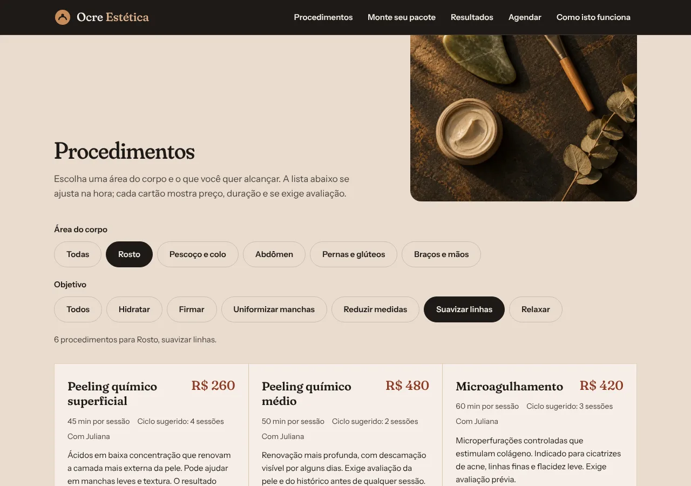
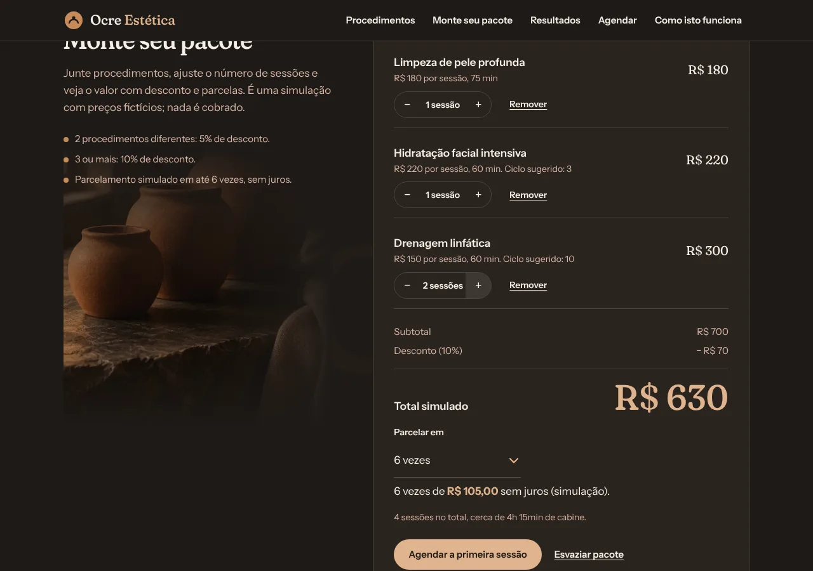
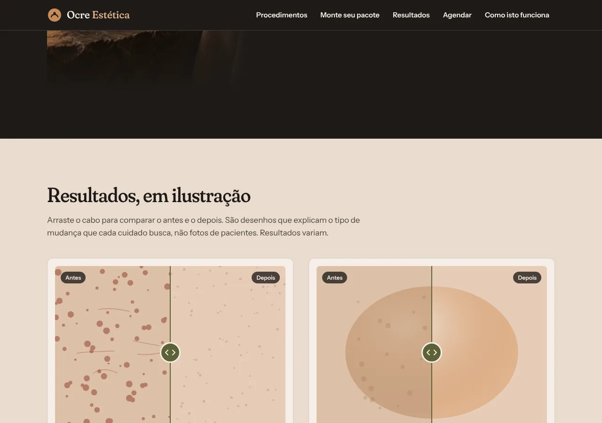
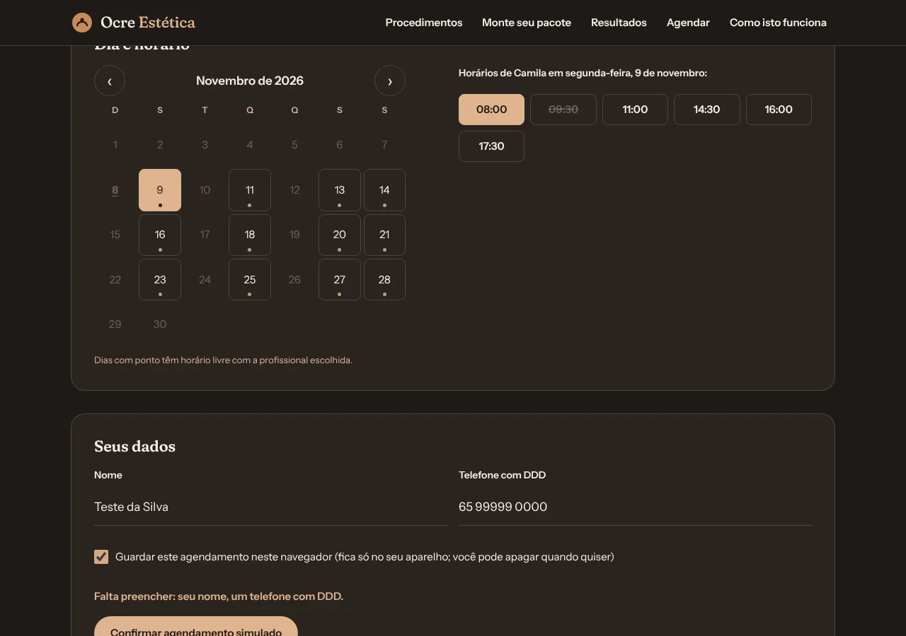

# Ocre Estética

Site de demonstração de uma clínica de estética e beleza. Eu, Rodrigo Jr, da [Mil e Uma Linhas!](https://mileumalinhas.com.br), fiz este site para mostrar a donas e donos de clínica o que um site próprio pode fazer: organizar os procedimentos, deixar a pessoa montar um pacote com preço na hora, explicar o que esperar de cada cuidado e marcar uma visita com a profissional certa.

Endereço quando publicado: https://toshiro01001.github.io/estetica/

**Tudo aqui é fictício.** A clínica Ocre não existe. Profissionais, registros, endereço, telefone, preços, agendas e os "resultados" ilustrados foram inventados. Nada é vendido, cobrado ou enviado; nenhum dado sai do seu aparelho.

## Capturas

| Computador | Celular |
|---|---|
|  |  |

| Catálogo com filtros | Simulador de pacote |
|---|---|
|  |  |

| Comparador de resultados | Agendamento |
|---|---|
|  |  |

No celular: [pacote](docs/celular-pacote.webp) e [agendamento](docs/celular-agendamento.webp).

## O que o site faz

1. **Procedimentos com filtro.** Toque em uma área do corpo (rosto, pescoço e colo, abdômen, pernas e glúteos, braços e mãos) e em um objetivo (hidratar, firmar, uniformizar manchas, reduzir medidas, suavizar linhas, relaxar). A lista se ajusta na hora. Cada cartão mostra preço, duração, ciclo sugerido, quem faz e, quando for o caso, a etiqueta "Exige avaliação".
2. **Monte seu pacote.** O botão "Adicionar ao pacote" leva o procedimento para o painel escuro. Lá você ajusta o número de sessões, vê subtotal, desconto (5% com 2 procedimentos, 10% com 3 ou mais), total e o valor de cada parcela em até 6 vezes. Tudo é simulação.
3. **Resultados, em ilustração.** Quatro comparadores com um cabo que você arrasta (ou move com as setas do teclado). São desenhos abstratos que explicam o tipo de mudança buscada; não são fotos de pacientes, e o texto diz que resultados variam.
4. **Agendar.** Escolha o procedimento, a profissional (só aparecem as que fazem aquele procedimento), o dia no calendário (só os dias em que ela atende e que ainda têm vaga) e o horário. Preencha nome e telefone e veja o resumo. Procedimentos invasivos só podem ser marcados como avaliação. Se quiser, guarde o agendamento no navegador; dá para apagar quando quiser.

## Como usar

1. Abra o site no celular ou no computador.
2. Em "Procedimentos", toque nos filtros e leia os cartões.
3. Toque em "Adicionar ao pacote" em dois ou três cartões e role até "Monte seu pacote" para ver o valor e as parcelas.
4. Em "Resultados", arraste o cabo verde para a esquerda e para a direita.
5. Em "Agendar", escolha procedimento, profissional, dia e horário, preencha nome e telefone e confirme. O resumo aparece na tela.

## Identidade visual

Estudo completo em [docs/identidade.md](docs/identidade.md). Resumo:

- **Nome e frase:** Ocre Estética. "Cuidado para a pele que você já tem."
- **Paleta:** Fuligem `#1E1A17` (fundo escuro quente), Areia `#E9DCCF` (fundo claro, tom de pele), Linho `#F6EFE7` (cartões e texto sobre escuro), Argila `#8C3A24` (o único destaque forte, um por tela), Oliva `#5C6136` (etiquetas, cabo do comparador), Ocre `#C68B59` (só em ilustração e foto).
- **Fontes:** Fraunces (títulos, com eixos SOFT e WONK ligados para dar personalidade de barro) e Instrument Sans (texto e interface). Ambas locais, SIL OFL.
- **Por quê:** estética é cuidado com a pele, e pele tem a cor da terra. Fugi do rosa de perfumaria e do dourado de promessa. A base escura e quente faz a clínica parecer um ateliê, não uma farmácia; a Argila aparece pouco para valer muito.
- **Imagem forte:** uma fotografia no hero, em contêiner 4:3. A imagem atual em `img/hero.webp` é provisória, gerada em código nas cores da identidade; o prompt para a foto definitiva está em `docs/identidade.md`.

## Como funciona por dentro

Em linguagem comum: o site é um conjunto de arquivos de texto que o navegador lê. A lista de procedimentos, as profissionais e as regras da agenda estão em um arquivo de dados (`js/dados.js`). Outro arquivo (`js/app.js`) desenha os cartões, aplica os filtros, soma o pacote, move o comparador e monta o calendário. Nada disso precisa de servidor: o GitHub Pages só entrega os arquivos e o resto acontece no seu aparelho.

Os horários "ocupados" não são aleatórios de verdade: o site calcula um número fixo a partir do nome da profissional, da data e do horário, então todo visitante vê a mesma agenda e ela não muda ao recarregar.

## Detalhes técnicos

- HTML, CSS e JavaScript puros. Sem framework, sem biblioteca, sem CDN, sem analytics.
- Arquivos: `index.html` (página única com âncoras), `css/estilo.css`, `js/dados.js`, `js/app.js`, `fonts/` (woff2 e licenças), `img/hero.webp`, `favicon.svg`, `404.html` (caminhos absolutos `/estetica/`), `robots.txt`, `sitemap.xml`, `google20db0e080e71c701.html`.
- `Content-Security-Policy` por meta: `default-src 'self'`, sem script nem estilo inline. Estilos dinâmicos via CSSOM.
- Acessibilidade: contraste AA verificado (tabela em `docs/identidade.md`), foco visível, filtros e profissionais como `radio` reais com rótulo, calendário com `aria-label` por dia, comparador como `input type="range"` com rótulo, `aria-live` nas listas que mudam, `prefers-reduced-motion` respeitado.
- `localStorage` só com a chave `ocre-agendamentos` e só se a pessoa marcar a caixa.

## Como rodar

```
python3 -m http.server 8308
```

Depois abra http://localhost:8308/ no navegador. Qualquer servidor de arquivos estáticos serve; abrir o `index.html` direto também funciona, exceto pela página 404, que usa caminhos absolutos do GitHub Pages.

## Testes

Com o servidor acima rodando e o Playwright instalado (`npm i playwright`):

```
node tests/site.cjs
```

O script abre o site em três telas (1280x900, iPhone 13 e 320px) e verifica: rolagem horizontal, elementos fora da borda, texto cortado, console sem erros, foto do hero carregada, filtros do catálogo (contagens e combinação vazia), cálculo do pacote (desconto, sessões, parcelas, remover, esvaziar), comparador (faixa move o corte), agendamento (pré-seleção, aviso de avaliação, profissionais aptas, dias da agenda, horários, validação, resumo, localStorage e apagar), menu do celular e página 404. Variável `CAPTURAS=pasta` salva PNGs de cada etapa.

Resultado desta versão: tudo certo nas três telas, sem erro de console.

## Segurança

Vistoria em [docs/vistoria.md](docs/vistoria.md). Em resumo: CSP restritiva, nenhum envio de dados, nenhuma dependência externa, `localStorage` opcional e apagável, nenhum dado real no repositório.

## Sobre

Feito por Rodrigo Jr, [Mil e Uma Linhas!](https://mileumalinhas.com.br), Cuiabá, MT. Se você tem uma clínica e quer um site assim, com a sua cara e os seus procedimentos de verdade, é só chamar.
